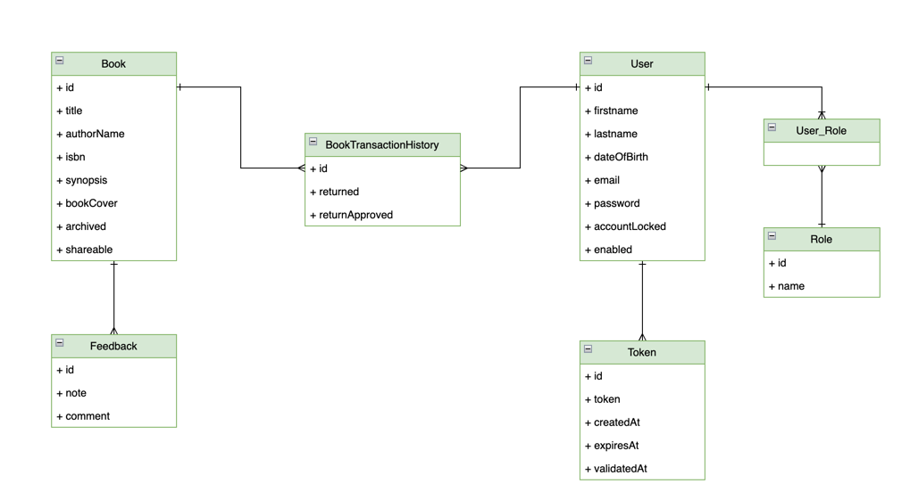
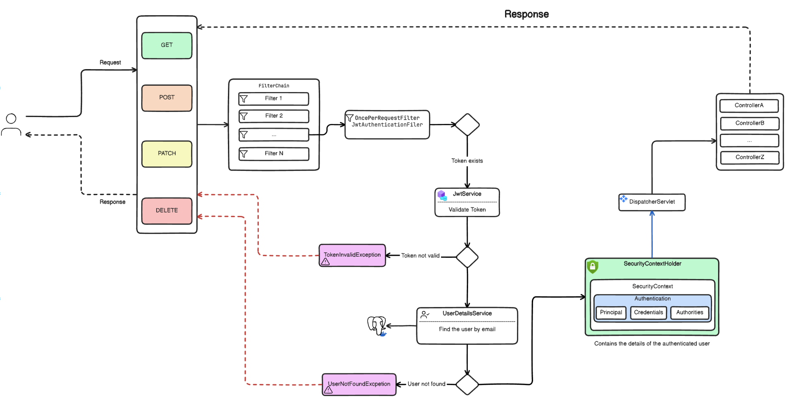
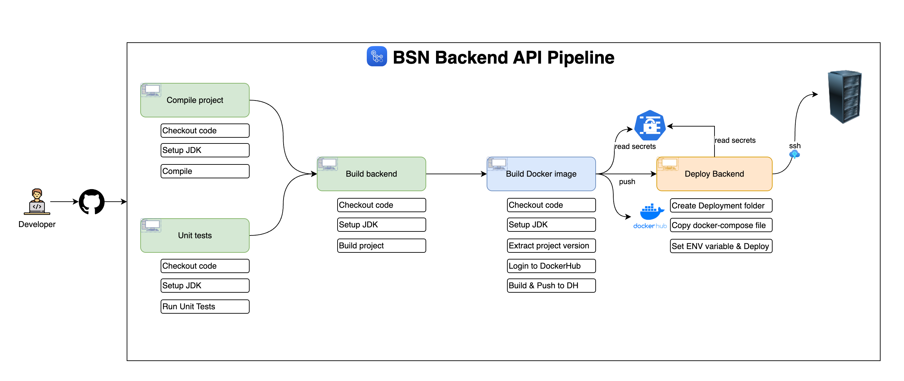
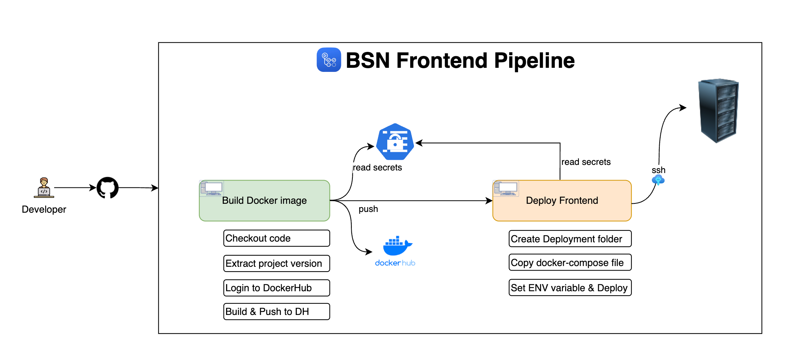

# 📚 Book Social Network


## Table of Contents

* [Overview](#overview)
* [Features](#features)
* [Diagrams](#diagrams)
* [Technologies Used](#technologies-used)

  * [Backend (book-social-network)](#backend-book-social-network)
  * [Frontend (book-social-network-ui)](#frontend-book-social-network-ui)
* [Learning Objectives](#learning-objectives)
* [License](#license)
* [Getting Started](#getting-started)
* [Contributors](#contributors)
* [Acknowledgments](#acknowledgments)

---

## Overview

**Book Social Network** is a full-stack web application that enables users to manage their book collections and connect with a community of book enthusiasts.

It includes:

* User registration and secure email validation
* Book management (creation, updating, sharing, archiving)
* Borrowing and returning books with availability checks
* Approval of book returns

🔐 Security is handled with **Spring Security 6 + JWT tokens**, following best practices in REST API design.
The backend is built with **Spring Boot 3**, and the frontend is developed with **Angular + Bootstrap**.

---

## Features

* 👤 **User Registration** – Create a new account
* 📧 **Email Validation** – Activate accounts via email verification
* 🔑 **Authentication** – Secure login with JWT-based sessions
* 📚 **Book Management** – Add, update, share, and archive books
* 📖 **Book Borrowing** – Check availability before borrowing
* 🔄 **Book Returning** – Return borrowed books
* ✅ **Return Approval** – Manage approval of returned books

---

#### Class diagram


#### Spring security diagram


#### Backend pipeline


#### Backend pipeline


## Technologies Used

### Backend (book-social-network)

* Spring Boot 3
* Spring Security 6 (JWT Authentication)
* Spring Data JPA
* JSR-303 & Spring Validation
* OpenAPI + Swagger UI (API Documentation)
* Docker (for containerization)

### Frontend (book-social-network-ui)

* Angular
* Component-Based Architecture
* Lazy Loading
* Authentication Guard
* Bootstrap

---

## Learning Objectives

This project is designed to help practice:

* Designing class diagrams from business requirements
* Implementing a monorepo structure (backend + frontend)
* Securing applications with **Spring Security & JWT**
* Registering users and validating accounts via email
* Implementing service & exception handling layers
* Validating data with JSR-303
* Designing REST APIs with pagination & best practices
* Using Spring Profiles for environment configs
* Documenting APIs with OpenAPI & Swagger UI
* Dockerizing applications

---

## License

This project is licensed under the **Apache License 2.0**.
See the [LICENSE](./LICENSE) file for details.

---

## Getting Started

### 🔧 Backend Setup

```bash
cd book-social-network
./mvnw spring-boot:run
```

### 🎨 Frontend Setup

```bash
cd book-social-network-ui
npm install
ng serve
```

---

## Contributors

* **Ali Bouali** (initial inspiration & tutorials)
* **Rayen Ben othman and Ahmed Dachroui** (implementation & customization)

---

## Acknowledgments

Special thanks to the maintainers of the frameworks and libraries used in this project.


